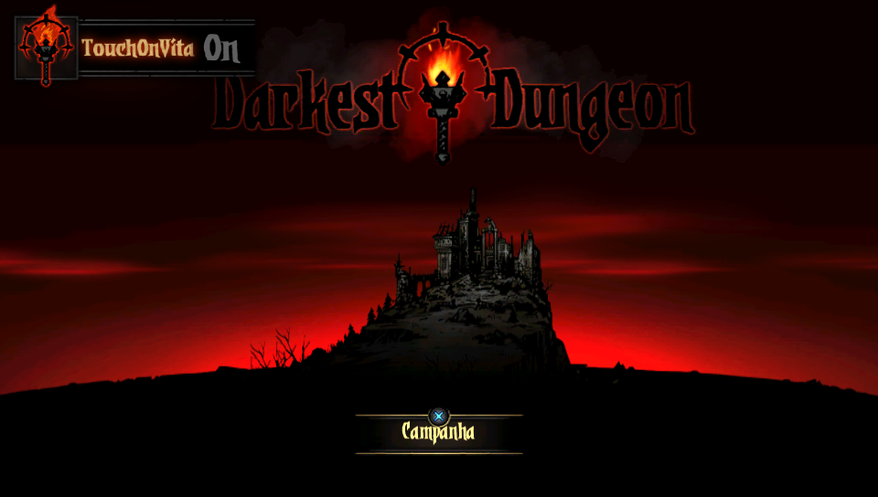
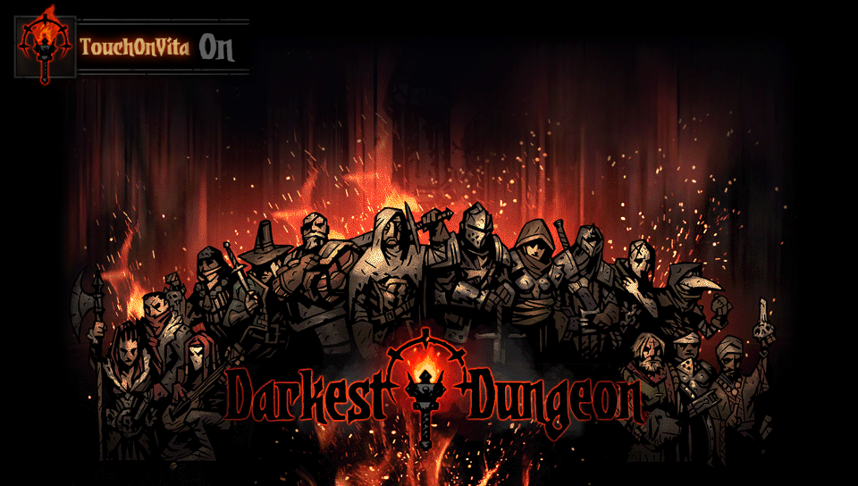
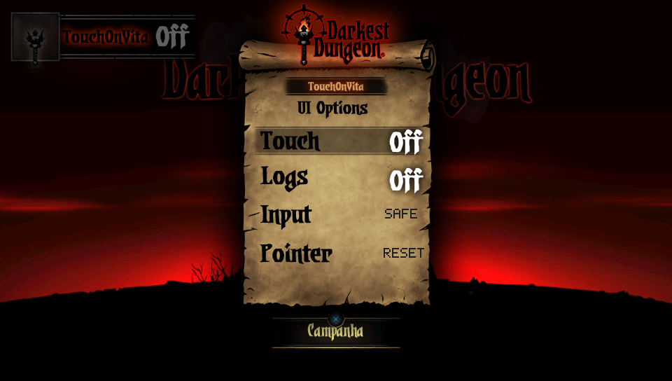
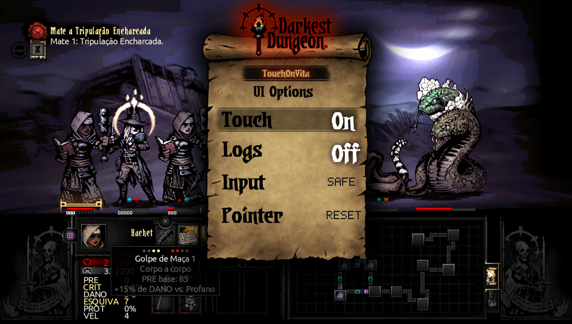

<p align="center">
  
</p>

<p align="center">
  <em>Native touchscreen controls for Darkest Dungeon on PlayStation Vita.</em>
</p>

<p align="center">
  
  
  
</p>

**TouchOnVita** is an unofficial taiHEN plugin that brings PC-style touch interaction to the PS Vita version of **Darkest Dungeon**. 

The goal is simple: 
* **Tap a UI element to select and activate it**, while keeping physical controls available.

## Features

- Single-tap selection and activation of recognized UI elements.
- Persistent touch focus, with seamless return to physical controls.
- Custom in-game settings panel with touch support and ON/OFF indicators.
- Fast panel transitions and optional UI sound effects.

## Screenshots

<p align="center">
  
  
</p>
<p align="center">
  
  
</p>


## Download
**[Download Latest Release](https://github.com/WolffsRoom/DD-TouchOnVita/releases/latest)**

Also available on the new Wolff's Room Store!

Visit [Wolff's Room](https://wolffsroom.github.io/WolffsRoomSite/) or download it directly through the Wolff's Store app for PlayStation Vita!


## Installation

**Requirements:** 

A homebrew-enabled PS Vita with taiHEN and a legitimate installation of **Darkest Dungeon** (`PCSE00919`).

1. Obtain `DDTouchUI.suprx` and the six UI `.rgba` files from the project build or release package.
2. Copy `DDTouchUI.suprx` to `ur0:tai/`.
3. Add the plugin to the **existing** `*PCSE00919` section of `ur0:tai/config.txt`:

   ```ini
   *PCSE00919
   ur0:tai/DDTouchUI.suprx
   ```

4. Copy `UI.rgba`, `Selector.rgba`, `On.rgba`, `Off.rgba`, `Mod_on.rgba` and `Mod_off.rgba` to `ux0:data/DDTouchUI/`.
5. Create `ux0:data/DDTouchUI/mode.ini`:

   ```ini
   mode=1
   fast_input=1
   spatial_only=1
   hover_persist=1
   widget_probe=1
   menu_click=1
   direct_click=1
   direct_all_widgets=1
   ui_sounds=0
   ```

6. Fully close and relaunch the game.

> [!IMPORTANT]
> This is a **`.suprx` plugin, not a VPK**. Back up your taiHEN configuration. If `*PCSE00919` already exists, add only the plugin line; do not create a second section.

## Controls

| Input | Action |
|---|---|
| Touchscreen | Select and activate supported UI elements |
| **Start + L** | Open / close the TouchOnVita panel |
| D-Pad, Cross, Circle | Navigate, confirm and close the panel |

## What Doesn't Work / Limitations

- Map dragging, inventory drag-and-drop and advanced multitouch gestures are not fully implemented.
- Not every save flow, menu or battle target has been verified; some interactions may still require physical controls.
- Optional UI sounds are disabled in the installation example and require separately obtained, authorized PCM assets.
- Compatibility with other game regions or updates is unknown.

## Tested Versions

| Environment | Version | Validation |
|---|---|---|
| **PS Vita** | **PCSE00919 — game update 1.17** | v0.58 touch functionality tested successfully; v0.59 installed and verified |
| **Vita3K** | Game update **1.16** | v0.59 starts and loads the hooks |

## AI NOTICE

Chat GPT Plus was used to assist with code analysis, automated testing, and development of this plugin.

<div align="center">

  <h2>Disclaimer</h2>

  <p>
    <em>
      Unofficial community project, not affiliated with Red Hook Studios or Sony.<br>
      The plugin does not include the game, save data or copyrighted game audio.
    </em>
  </p>

  

  <p>
    <strong>Made by <a href="https://github.com/WolffsRoom">Wolff's Room</a></strong>
  </p>

</div>
